# 🛡️ prox0x — Suite DAST y proxy de auditoría web


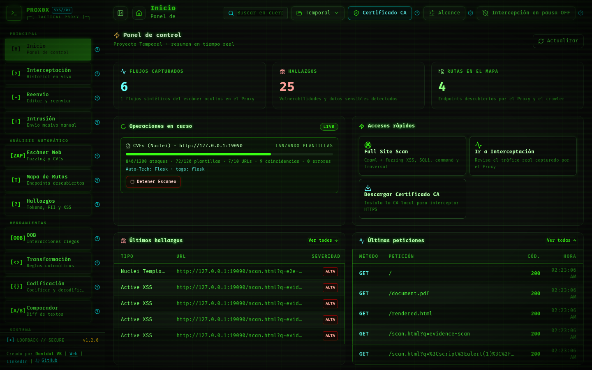

**prox0x** es un **proxy interceptador y suite DAST autónoma** para pentesting,
red team, laboratorios y Bug Bounty autorizado. Reúne en un único binario todo
lo necesario para **capturar, modificar, repetir, fuzzear y auditar** tráfico
HTTP/HTTPS, sin Java, sin Electron y sin dependencias externas.

- 🔎 Interceptación HTTP/1.1, HTTP/2 y WebSockets.
- ✏️ Reenvío y edición manual de peticiones.
- 💥 Intruder con cuatro modos de ataque.
- 🧠 Escáner pasivo de tokens, PII, XSS reflejado y recon.
- ⚡ Escáner Web con Full Site Scan y miles de payloads.
- 🏠 Dashboard en tiempo real.
- 📡 Out-of-Band local o con Interactsh online.
- 🗺️ Crawler independiente y Mapa de Rutas.
- 🎯 Alcance, Decoder, Comparador, Transformación y más.

> 🧪 Diseñado exclusivamente para **auditorías éticas** y sistemas propios o
> autorizados.

---

## 🛡️ Novedades en la v1.2.0: Detección de CVEs y Nuevo Diseño

La versión **1.2.0** convierte a prox0x en una suite DAST completa con
detección de vulnerabilidades conocidas. Estas son las funciones nuevas y su
aspecto real en la interfaz.

### 🧬 CVEs con Nuclei

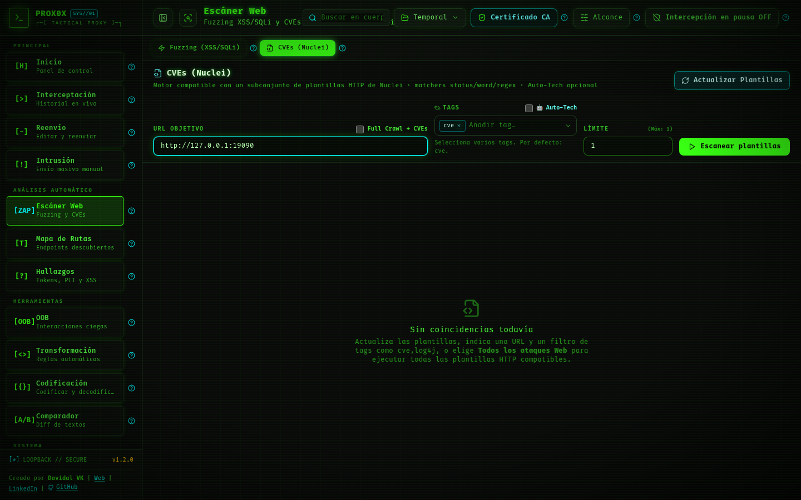

El módulo **Escáner Web → CVEs (Nuclei)** ejecuta plantillas HTTP compatibles
con Nuclei (más de **14.000 plantillas** en el catálogo oficial): CVEs,
exposiciones, paneles expuestos, credenciales por defecto y detecciones de
tecnología. Permite elegir tags, limitar el número de plantillas, activar
Auto-Tech y lanzar un **Full Crawl + CVEs** sobre todas las rutas descubiertas.

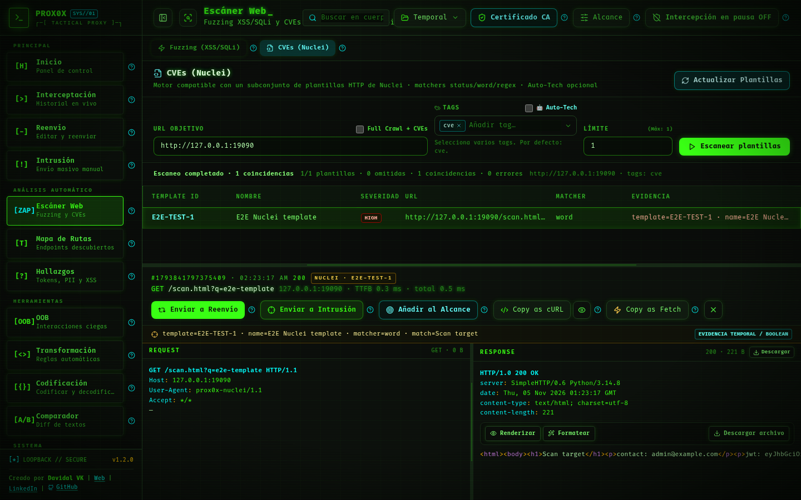

Cada coincidencia genera un flujo y un hallazgo con severidad, matcher,
evidencia y el detalle exacto de la petición/respuesta del template.

### 🤖 Auto-Tech

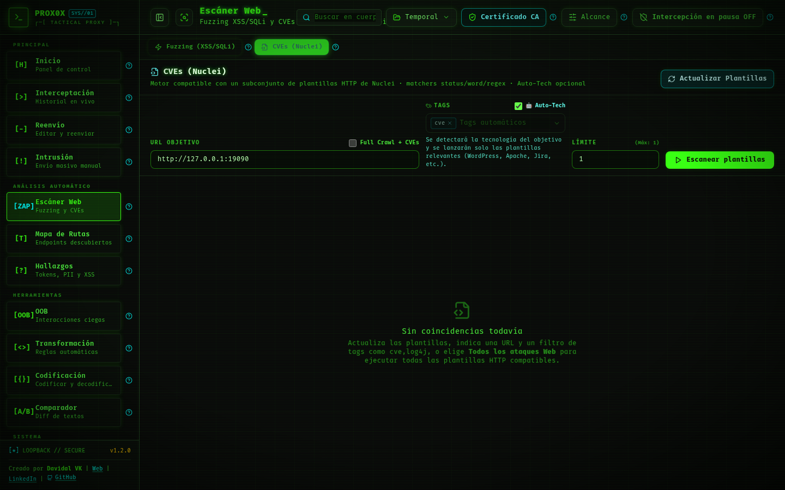

Con **🤖 Escaneo Inteligente (Auto-Tech)** activo, prox0x analiza cabeceras,
cookies, metaetiquetas, HTML y rutas comunes del objetivo para detectar su
tecnología (WordPress, Apache, Nginx, Jira, Spring Boot, Flask, PHP, Laravel,
Drupal, Joomla, etc.) y traducirla a tags de Nuclei. El selector manual de tags
se deshabilita y solo se ejecutan las plantillas relevantes. Si no hay
coincidencias en el catálogo local, se conservan los tags manuales como
fallback.

### 🕸️ Crawler configurable

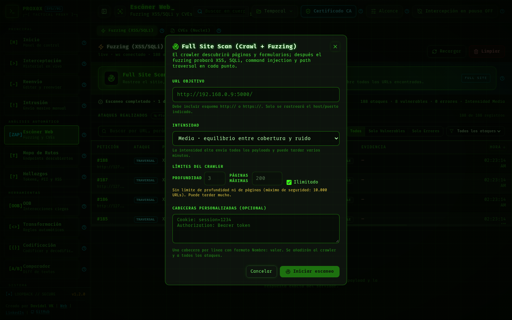

El crawler ya no tiene límites fijos. Full Site Scan, CVEs y Mapa de Rutas
permiten configurar:

- **Profundidad**: niveles de enlaces a seguir (1 = solo la semilla).
- **Páginas máximas**: URLs a visitar.
- **Ilimitado**: ignora ambos límites con un tope de seguridad de **10.000
  URLs** para evitar agotar memoria.

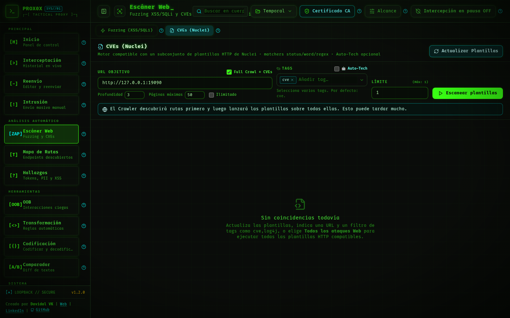

En CVEs, **Full Crawl + CVEs** rastrea primero el dominio y después lanza las
plantillas sobre todas las URLs descubiertas, mostrando las fases de rastreo y
escaneo por separado.

### 🧭 Nuevo Sidebar agrupado

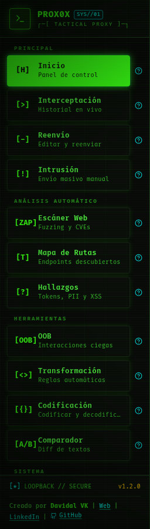

El menú lateral se organiza en cuatro grupos claros:

- **Principal**: Inicio, Interceptación, Reenvío, Intrusión.
- **Análisis Automático**: Escáner Web, Mapa de Rutas, Hallazgos.
- **Herramientas**: OOB, Transformación, Codificación, Comparador.
- **Sistema**: Ajustes, Alcance.

Los módulos se renombraron a **Escáner Web**, **Fuzzing (XSS/SQLi)**,
**CVEs (Nuclei)**, **Intrusión** y **Mapa de Rutas**. La cabecera global muestra
icono, título y subtítulo en todas las vistas, y el botón de colapsar sigue
funcionando con persistencia en `localStorage`.

### 📊 Dashboard con operaciones CVEs


El Dashboard incorpora las operaciones de **CVEs (Nuclei)** en curso con fase
(detectando tecnología, rastreando, lanzando plantillas), barra de progreso,
ataques realizados/totales, plantillas ejecutadas y botón **Detener Escaneo**.

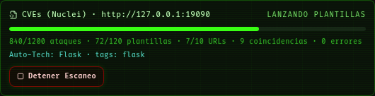

Cuando Auto-Tech está activo también muestra la tecnología detectada y los
tags efectivos.

> Las plantillas de Nuclei son de ProjectDiscovery y se distribuyen bajo
> licencia MIT. Consulta la sección de
> [Créditos y Agradecimientos](#-créditos-y-agradecimientos).

---

## 🚀 Novedades en la v1.1.0: Suite DAST Autónoma

La versión **1.1.0** convierte a prox0x en una suite DAST completa:

- 🏠 **Dashboard (Inicio)** con estadísticas del proyecto, operaciones en curso,
  últimos hallazgos, últimas peticiones y accesos rápidos. Todo en vivo.
- 🕸️ **Full Site Scan**: crawler + Escáner Web automático sobre todas las
  URLs y formularios descubiertos, con miles de payloads y tres intensidades.
- 🧠 **Detección avanzada**: Blind SQLi time-based y boolean-based, Command
  Injection, XSS contextual, Path Traversal y evasiones de WAF.
- 🔦 **Panel de evidencia resaltada**: el fragmento exacto que disparó la alarma
  se marca en la respuesta. Incluye acciones rápidas:
  - Enviar la petición exacta a Reenvío.
  - Copy as cURL con el payload inyectado.
  - Copiar Evidencia (MD) para informes.
- 🔐 **Cabeceras personalizadas**: `Cookie`, `Authorization` y otras cabeceras
  para auditar zonas autenticadas.
- ⏹️ **Detener Escaneo**: cancelación inmediata de un escaneo en curso.
- 🧹 **Interceptación limpia**: el tráfico sintético del escáner queda oculto
  por defecto y se puede mostrar con un checkbox.
- 🗂️ **Filtros y ordenación** en el Escáner Web por texto, resultado, tipo de
  ataque, hora, código y severidad.
- 🗺️ **Crawler independiente** integrado en el Mapa de Rutas.

### 🔧 v1.1.1 — Mantenimiento

Esta versión mantiene todas las funciones de la v1.1.0 e incluye:

- Corrección del resaltado de evidencia en respuestas grandes: la evidencia ya
  no se pierde cuando aparece más allá de los primeros 64 KB.
- Desplazamiento automático del panel de respuesta hasta el fragmento marcado.
- Mejora visual de la columna **Tipo** en los últimos hallazgos del Dashboard.
- Tests adicionales para respuestas grandes con evidencia remota.

---

## 🥊 ¿Por qué elegir prox0x?

| Característica | 🛡️ **prox0x** | 💼 Suites comerciales habituales |
|---|---|---|
| **Precio** | ✅ **100% gratis**. | 💰 Suscripción o licencia. |
| **Distribución** | ✅ **Un único binario**. Sin Java, Node ni dependencias. | 🧱 Instaladores pesados o runtime propio. |
| **Límites** | ✅ Todas las funciones desbloqueadas. | 🔒 Funciones o volumen según plan. |
| **Proxy MITM** | ✅ HTTP/1.1, HTTP/2 y CA ECDSA P-256. | ✅ Normalmente en edición Pro. |
| **WebSockets** | ✅ Relay, inspección y edición de frames. | ✅ Según producto y plan. |
| **Interceptación** | ✅ 4 puntos HTTP + frames WS, Forward/Drop y edición. | ✅ Según producto. |
| **Reenvío** | ✅ Single, Sequential y Parallel. | ✅ Generalmente incluido. |
| **Intruder** | ✅ Sniper, Battering Ram, Pitchfork y Cluster Bomb. | ✅ A menudo limitado por plan. |
| **Escáner pasivo** | ✅ JWT, AWS, Google API keys, Bearer, emails, teléfonos, passwords, URLs, endpoints, subdominios y XSS reflejado. | ✅ Habitual en planes Pro o extensiones. |
| **Escáner activo** | ✅ XSS contextual, SQLi error/UNION/blind/time, Command Injection, Path Traversal, Full Site Scan y evidencia resaltada. | ✅ Catálogo variable según producto. |
| **OOB** | ✅ Servidor local + Interactsh online con fallback. | ✅ Collaborator/OOB normalmente de pago. |
| **Crawler / rutas** | ✅ Crawler independiente y Mapa de Rutas con métodos y contadores. | ✅ Incluido en la mayoría. |
| **Transformación** | ✅ Request/Response, headers/body/all, regex y recálculo de `Content-Length`. | ✅ Según producto. |
| **Alcance** | ✅ Regex de inclusión/exclusión y reevaluación retroactiva. | ✅ Generalmente incluido. |
| **Informes** | ✅ Informe HTML autocontenido. | ✅ Normalmente en planes avanzados. |
| **Multi-proyecto** | ✅ Proyectos aislados y cambio en caliente. | ✅ Según producto. |
| **Persistencia** | ✅ SQLite WAL **100% local**. | ✅ Local o nube propietaria. |
| **Interfaz** | ✅ Tema táctico CRT, paneles arrastrables y atajos. | 🎨 Interfaz convencional. |
| **Rendimiento** | ✅ Binario nativo, sin JVM ni Electron. | 🐌 Java/Electron añaden overhead. |
| **Plataformas** | ✅ Linux, macOS y Windows. | ✅ Instaladores separados. |

---

## 📚 Índice

1. [Novedades v1.2.0](#️-novedades-en-la-v120-detección-de-cves-y-nuevo-diseño)
2. [Novedades v1.1.0](#-novedades-en-la-v110-suite-dast-autónoma)
3. [Descarga e instalación](#-descarga-e-instalación)
4. [Primer arranque](#-primer-arranque)
5. [Certificado CA](#-certificado-ca)
6. [FoxyProxy](#-configurar-foxyproxy)
7. [Quick Start](#-quick-start-en-4-pasos)
8. [Dashboard](#-dashboard-inicio)
9. [Interceptación](#-interceptación)
10. [Reenvío](#-reenvío)
11. [Intrusión](#-intrusión-intruder)
12. [Hallazgos](#-hallazgos)
13. [Escáner Web](#-escáner-web)
14. [Mapa de Rutas](#-mapa-de-rutas)
15. [OOB](#-out-of-band-oob)
16. [Comparador](#-comparador)
17. [Codificación](#-codificación)
18. [Transformación](#-transformación)
19. [Ajustes](#-ajustes)
20. [Alcance](#-alcance-scope)
21. [Proyectos](#-proyectos-y-bienvenida)
22. [API y CLI](#-api-y-cli)
23. [Solución de problemas](#-solución-de-problemas)
24. [Seguridad y aviso legal](#-seguridad-y-aviso-legal)
25. [Licencia](#-licencia)

---

## 📥 Descarga e instalación

👉 **Releases oficiales:**  
https://github.com/davidalvk/prox0x-releases/releases

| Sistema | Archivo | Notas |
|---|---|---|
| 🐧 Linux x86_64 | `prox0x-linux` | `chmod +x` y ejecutar |
| 🪟 Windows | `prox0x-windows.exe` | Doble clic |
| 🍎 macOS | `prox0x-macos` | Intel x86_64 / Rosetta 2 en Apple Silicon |

> 💡 Los binarios incluyen Python, backend, UI y dependencias. No necesitas
> instalar Python ni Node.js.

### 🐧 Linux

```bash
chmod +x prox0x-linux
./prox0x-linux
```

Instalación opcional:

```bash
mkdir -p ~/.local/bin
mv prox0x-linux ~/.local/bin/prox0x
chmod +x ~/.local/bin/prox0x
prox0x
```

### 🪟 Windows

1. Descarga `prox0x-windows.exe`.
2. Doble clic.
3. Si SmartScreen aparece: **Más información** → **Ejecutar de todas formas**.
4. Permite el acceso en redes privadas si el Firewall lo pregunta.

### 🍎 macOS

```bash
chmod +x prox0x-macos
xattr -d com.apple.quarantine prox0x-macos 2>/dev/null || true
./prox0x-macos
```

> El binario macOS es **Intel x86_64**. En Apple Silicon funciona con Rosetta 2.

---

## 🚀 Primer arranque

| Servicio | Dirección |
|---|---|
| 🖥️ UI / API | `http://127.0.0.1:8000` |
| 🕸️ Proxy HTTP | `127.0.0.1:8080` |
| 📡 OOB local | `127.0.0.1:9999` |

- Datos en **`~/.prox0x/`**.
- El navegador se abre automáticamente.
- Para detener: **Ctrl+C**.

Si el navegador no se abre:

```text
http://127.0.0.1:8000
```

### Opciones útiles

| Opción / variable | Descripción |
|---|---|
| `--help` | Ver todas las opciones |
| `--no-browser` | No abrir navegador |
| `PROX0X_NO_BROWSER=1` | Igual que `--no-browser` |
| `--passphrase "..."` | Frase de paso de la CA |
| `PROX0X_CA_PASSPHRASE="..."` | Igual que la opción anterior |
| `PROX0X_STATE_DIR` | Directorio de estado |
| `PROX0X_CA_DIR` | Directorio de la CA |
| `PROX0X_PROJECTS_DIR` | Directorio de proyectos |

---

## 🔐 Certificado CA

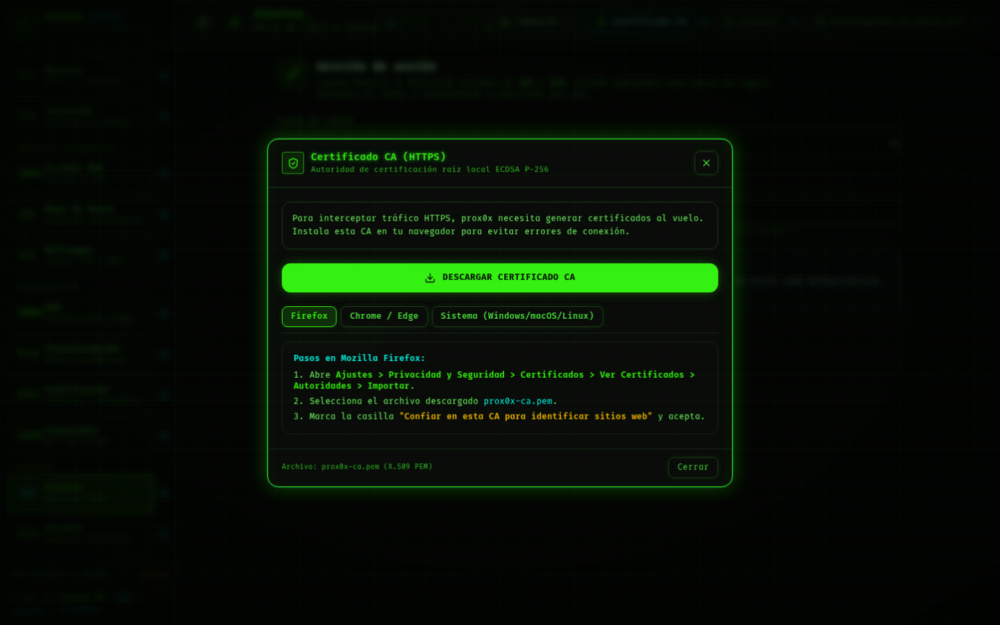

> 🚨 **CRÍTICO:** sin instalar la CA no podrás interceptar HTTPS.

### Descargar

1. Abre `http://127.0.0.1:8000`.
2. Pulsa **Certificado CA**.
3. Pulsa **Descargar Certificado CA**.
4. Se descarga `prox0x-ca.pem`.

### 🦊 Firefox

1. **Ajustes** → **Privacidad y Seguridad**.
2. **Certificados** → **Ver Certificados** → **Autoridades**.
3. **Importar** → selecciona `prox0x-ca.pem`.
4. Marca **Confiar en esta CA para identificar sitios web**.
5. Reinicia Firefox.

### 🌐 Chrome / Edge / Chromium

1. **Configuración** → **Privacidad y seguridad**.
2. **Seguridad** → **Gestionar certificados**.
3. **Autoridades de certificación** → **Importar**.
4. Selecciona `prox0x-ca.pem` y confía en ella.
5. Reinicia el navegador.

### Linux

**Fedora / RHEL / Arch**

```bash
sudo cp prox0x-ca.pem /etc/pki/ca-trust/source/anchors/prox0x-ca.crt
sudo update-ca-trust
```

**Debian / Ubuntu / Kali**

```bash
sudo cp prox0x-ca.pem /usr/local/share/ca-certificates/prox0x-ca.crt
sudo update-ca-certificates
```

### macOS

```bash
sudo security add-trusted-cert -d -r trustRoot \
  -k /Library/Keychains/System.keychain prox0x-ca.pem
```

### Windows

1. Doble clic en `prox0x-ca.pem`.
2. **Instalar certificado** → **Equipo local**.
3. **Siguiente** → **Colocar todos los certificados en el siguiente almacén**.
4. **Autoridades de certificación raíz de confianza**.
5. Finalizar y reiniciar el navegador.

---

## 🧭 Configurar FoxyProxy

1. Instala **FoxyProxy** en Firefox o Chrome.
2. Crea un proxy manual:
   - **Tipo:** HTTP
   - **Host:** `127.0.0.1`
   - **Puerto:** `8080`
3. Actívalo solo para las URLs del objetivo.

También puedes usar `curl`:

```bash
curl -x http://127.0.0.1:8080 http://objetivo.local/
```

---

## ⚡ Quick Start en 4 pasos

1. **Arranca prox0x** y carga un proyecto.
2. **Instala la CA** y configura FoxyProxy.
3. **Navega** por el objetivo para capturar tráfico.
4. Abre **Inicio** o **Escáner Web** y lanza un Full Site Scan.

---

## 🏠 Dashboard (Inicio)


El Dashboard es el punto de entrada del proyecto:

- **Flujos capturados**: tráfico real del Proxy.
- **Hallazgos**: pasivos y activos acumulados.
- **Rutas en el mapa**: endpoints descubiertos por Proxy y crawler.
- **Operaciones en curso**: progreso en vivo de Full Site Scan, Crawler y
  **CVEs (Nuclei)**, con fase, ataques, plantillas y botón de detener.
- **Últimos hallazgos**: mini-tabla con tipo, URL y severidad.
- **Últimas peticiones**: método, ruta, código y hora.
- **Accesos rápidos**:
  - Full Site Scan.
  - Ir a Interceptación.
  - Descargar Certificado CA.


Los datos se refrescan cada 3 segundos y los WebSockets actualizan las tablas
en tiempo real.

---

## 🔎 Interceptación

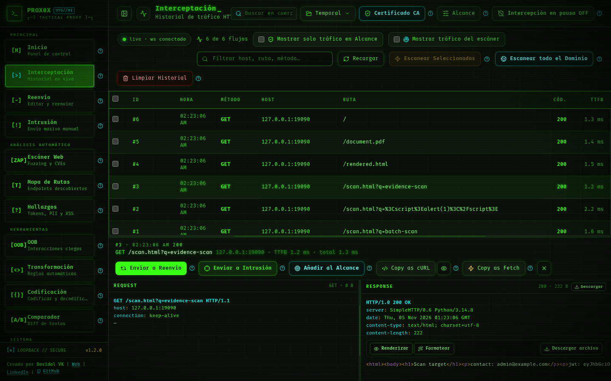

Vista principal del Proxy:

- Historial en vivo por WebSocket.
- Tabla con ID, hora, método, host, ruta, código y TTFB.
- Filtro por host, ruta o método.
- **Mostrar solo tráfico en Alcance**.
- **Mostrar tráfico del escáner**: oculto por defecto para mantener limpio el
  historial real.
- **Escanear Seleccionadas** y **Escanear todo el Dominio**.
- **Limpiar Historial** con confirmación.
- Detalle dividido en **Request** y **Response**, con separadores arrastrables.
- **Enviar a Reenvío**, **Enviar a Intrusión**, **Añadir al Alcance**.
- **Copy as cURL** y **Copy as Fetch**.
- Visores para:
  - texto con resaltado de sintaxis;
  - imágenes PNG, JPEG, GIF, WebP, BMP, ICO y AVIF;
  - PDF nativo o Base64;
  - HTML renderizado en iframe sandbox o código;
  - binarios en hex dump o texto Latin-1.
- Formateo de JSON, HTML, XML, CSS y JavaScript.
- Descarga del cuerpo original, descomprimido o comprimido.
- Badges de flujos modificados por reglas, descartados o fuera de Alcance.

---

## ✏️ Reenvío

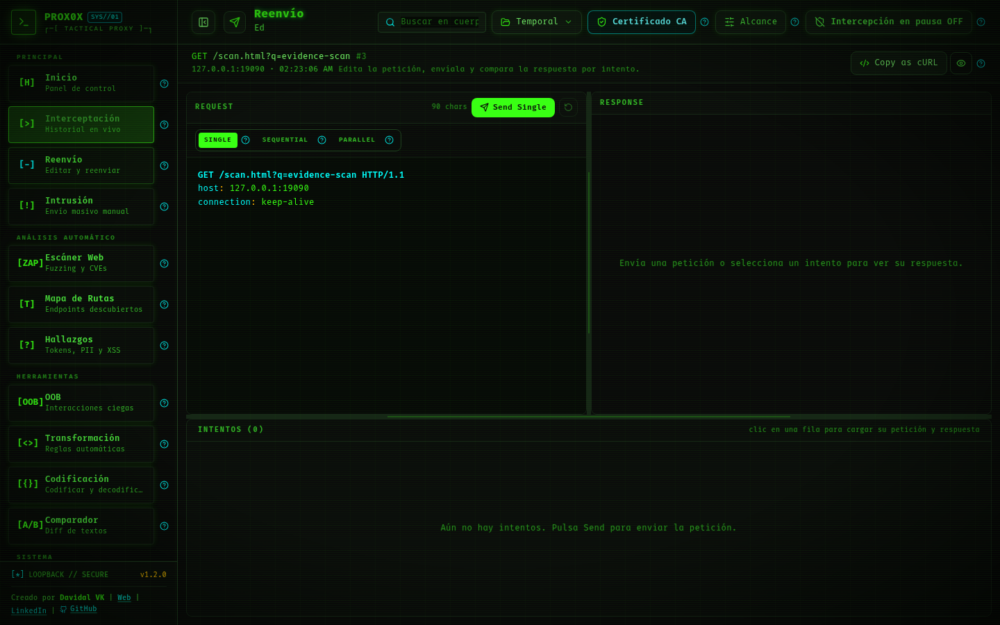

Editor de peticiones con:

- Petición y respuesta lado a lado.
- Modos **Single**, **Sequential** y **Parallel**.
- Número de envíos, concurrencia y delay configurables.
- Historial de intentos con estado, código, tamaño, TTFB y total.
- Clic en un intento para recuperar su petición y respuesta exactas.
- Diff contra la respuesta original.
- **Copy as cURL** con la petición editada.

---

## 💥 Intrusión (Intruder)

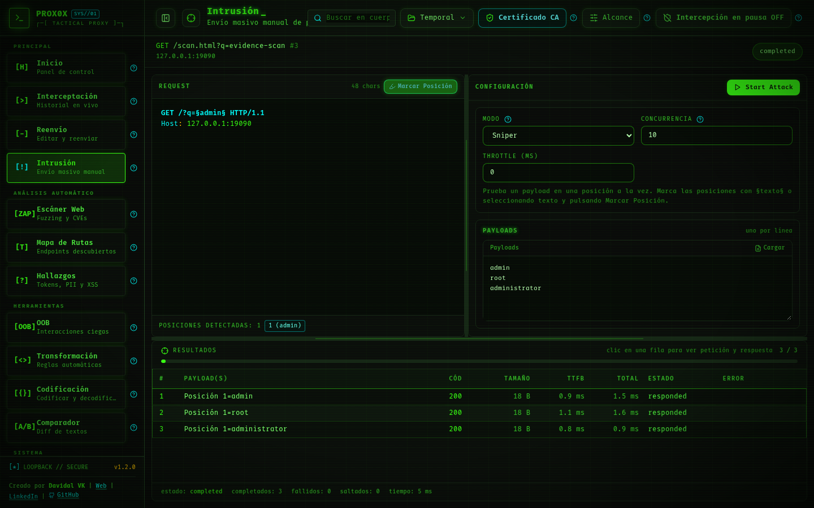

Fuzzing y fuerza bruta con cuatro modos:

- **Sniper**: un payload en una posición cada vez.
- **Battering Ram**: el mismo payload en todas las posiciones.
- **Pitchfork**: un payload distinto por posición, en paralelo.
- **Cluster Bomb**: todas las combinaciones de payloads.

Opciones:

- Payloads manuales o desde archivo.
- Varios payload sets.
- Procesadores: URL-encode, prefijo, sufijo, skip.
- Concurrencia, delay y límite de peticiones.
- Resultados en vivo con código, tamaño, TTFB, total y errores.
- Detalle de cada intento con request/response.

---

## 🧠 Hallazgos

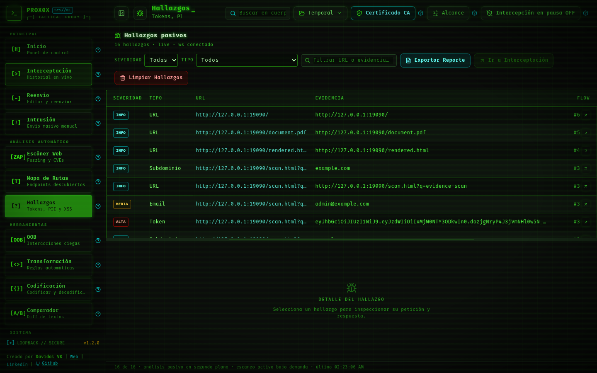

El escáner pasivo analiza el tráfico y detecta:

- Tokens JWT, AWS, Google API keys, Bearer y passwords.
- Emails, teléfonos, URLs y subdominios.
- Endpoints y posibles XSS reflejados.
- Hallazgos activos del Escáner Web.

Incluye:

- Filtros por severidad, tipo y texto.
- Tabla con severidad, tipo, URL, evidencia y flow.
- Detalle embebido con Request/Response.
- Salto directo a Interceptación.
- Informe HTML autocontenido.
- Limpieza de hallazgos del proyecto.

---

## ⚡ Escáner Web

El **Escáner Web** agrupa dos modos de análisis: **Fuzzing (XSS/SQLi)** y
**CVEs (Nuclei)**.

### Fuzzing (XSS/SQLi)

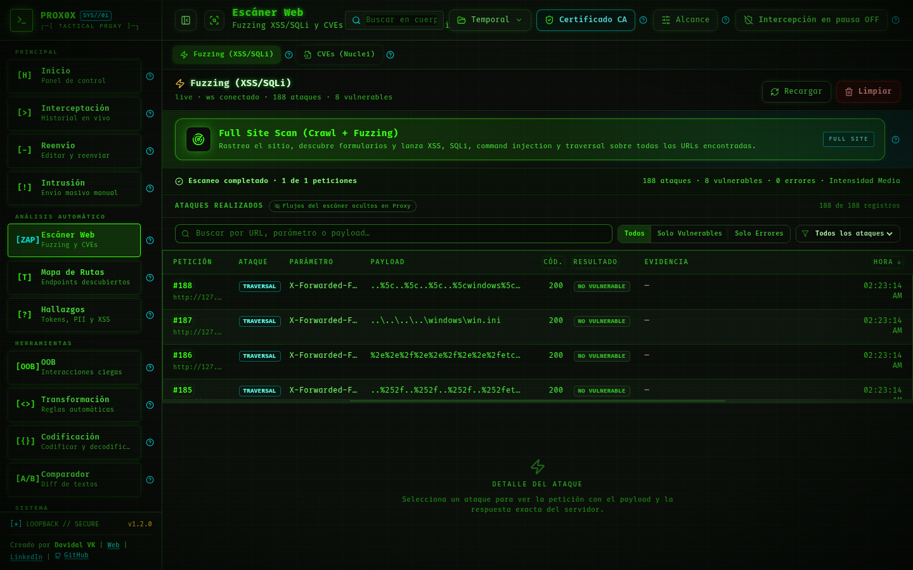

El modo Fuzzing cubre:

- **XSS contextual** con canary y múltiples contextos HTML/JS.
- **SQLi**: error-based, UNION, auth bypass, boolean-based y time-based.
- **Command Injection**: salida directa y delays.
- **Path Traversal** con bypasses de encoding.
- **URL, formularios, JSON anidado, cookies y cabeceras**.

### Full Site Scan

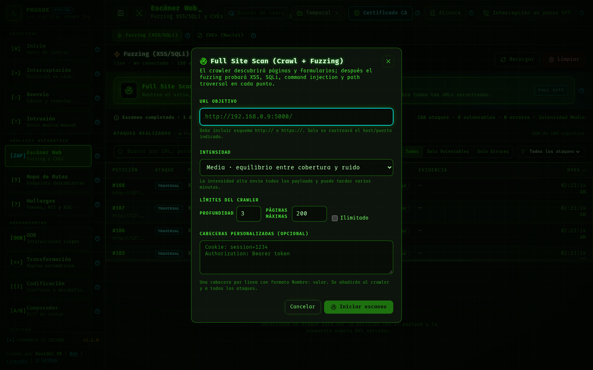

Opciones del modal:

- URL objetivo.
- **Crawler configurable**: profundidad (3 por defecto), páginas máximas (200
  por defecto) e **Ilimitado** (tope de seguridad de 10.000 URLs).
- Intensidad:
  - **Baja**: payloads básicos.
  - **Media**: cobertura equilibrada.
  - **Alta**: todos los payloads y técnicas time-based.
- **Cabeceras personalizadas (Opcional)**: una por línea, por ejemplo:

```text
Cookie: session=1234
Authorization: Bearer token
```

- **Iniciar escaneo**.
- **Detener Escaneo** durante la ejecución.

El Full Site Scan:

1. Rastrea según la profundidad y páginas configuradas, descubriendo
   formularios y endpoints.
2. Construye hasta 80 flujos objetivo.
3. Ejecuta el fuzzing XSS/SQLi/Command/Traversal con la intensidad elegida.
4. Guarda ataques, hallazgos y evidencias.

### CVEs (Nuclei)


La pestaña **CVEs (Nuclei)** ejecuta plantillas HTTP compatibles con Nuclei
sobre la URL indicada o sobre todas las rutas descubiertas con **Full Crawl +
CVEs**. Incluye Auto-Tech, selección de tags, límite de plantillas, tabla de
coincidencias y detalle de la petición/respuesta exacta. Consulta la
[galería de novedades v1.2.0](#️-novedades-en-la-v120-detección-de-cves-y-nuevo-diseño)
para ver Auto-Tech, los límites del crawler y los resultados con capturas.

### Tabla de ataques

- Filtros por URL/parámetro/payload.
- **Todos / Solo Vulnerables / Solo Errores**.
- Filtro por tipo: XSS, SQLi, Command Injection, Path Traversal.
- Contador dinámico.
- Ordenación por hora, resultado y código.
- IDs cortos y truncados.
- Resultado vulnerable con glow; seguro atenuado.

### Evidencia y acciones

- El fragmento exacto que disparó la alarma se resalta con `<mark>`.
- Badge **Evidencia encontrada aquí ↓**.
- Botones rápidos:
  - **Enviar a Reenvío** con la petición exacta.
  - **Copy as cURL** con el payload inyectado.
  - **Copiar Evidencia (MD)** con formato listo para informe.

Ejemplo de Markdown copiado:

```markdown
**Vulnerabilidad:** XSS
**URL:** http://objetivo.local/buscar?q=test
**Parámetro:** q
**Payload:** <script>alert(1)</script>
**Evidencia:** q=<script>alert(1)</script> reflejado en contexto html sin escapar
```

---

## 🗺️ Mapa de Rutas

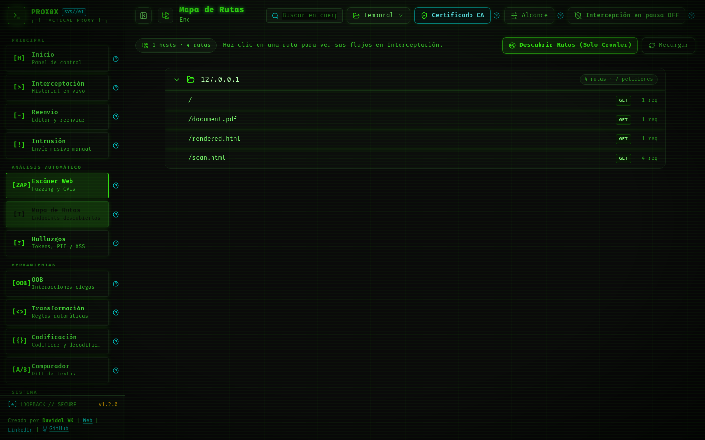

Árbol `host → ruta` con:

- Métodos HTTP por ruta.
- Contador de peticiones.
- Filtro directo a Interceptación.
- **Descubrir Rutas (Solo Crawler)**:
  - crawler independiente sin ataques;
  - profundidad, páginas máximas e **Ilimitado** configurables;
  - progreso con URLs, páginas y formularios;
  - persistencia en `crawl_routes`;
  - actualización automática del árbol.

---

## 📡 Out-of-Band (OOB)

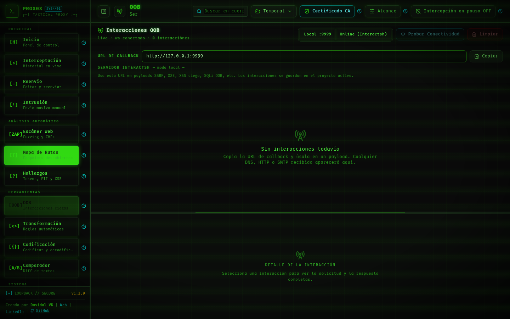

Dos modos:

- **Local**: servidor en `127.0.0.1:9999`.
- **Online**: Interactsh con fallback automático entre servidores públicos.

Incluye:

- URL de callback copiable.
- Prueba de conectividad.
- Tabla de interacciones DNS/HTTP/SMTP.
- Detalle raw de cada interacción.
- Limpieza de registros.

---

## 🆚 Comparador

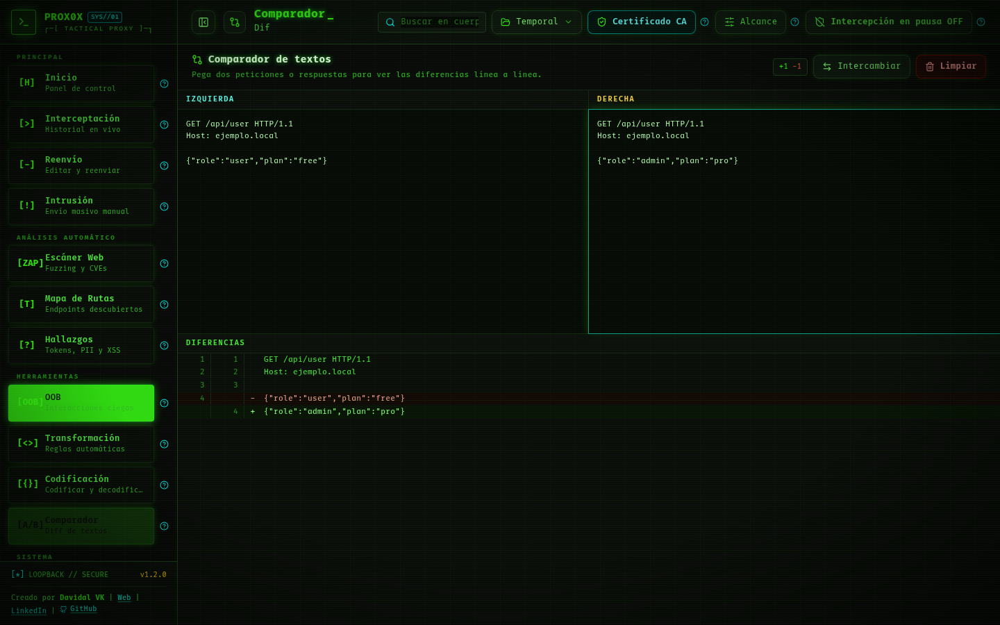

Diff línea a línea entre:

- dos peticiones;
- dos respuestas;
- texto pegado manualmente.

Resalta líneas añadidas y eliminadas.

---

## 🔢 Codificación

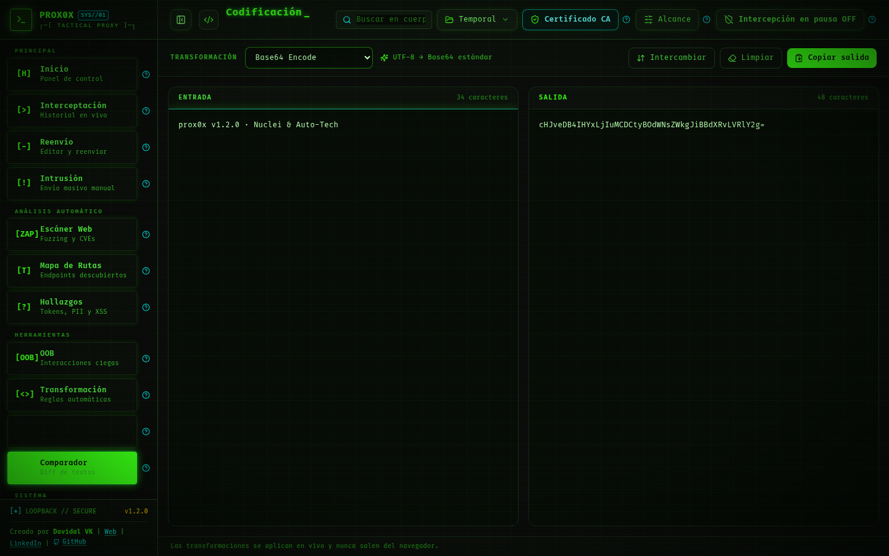

Herramientas locales:

- Base64.
- URL encode/decode.
- Hex.
- MD5.
- SHA-1.
- SHA-256.
- JSON Pretty Print.

---

## 🔧 Transformación

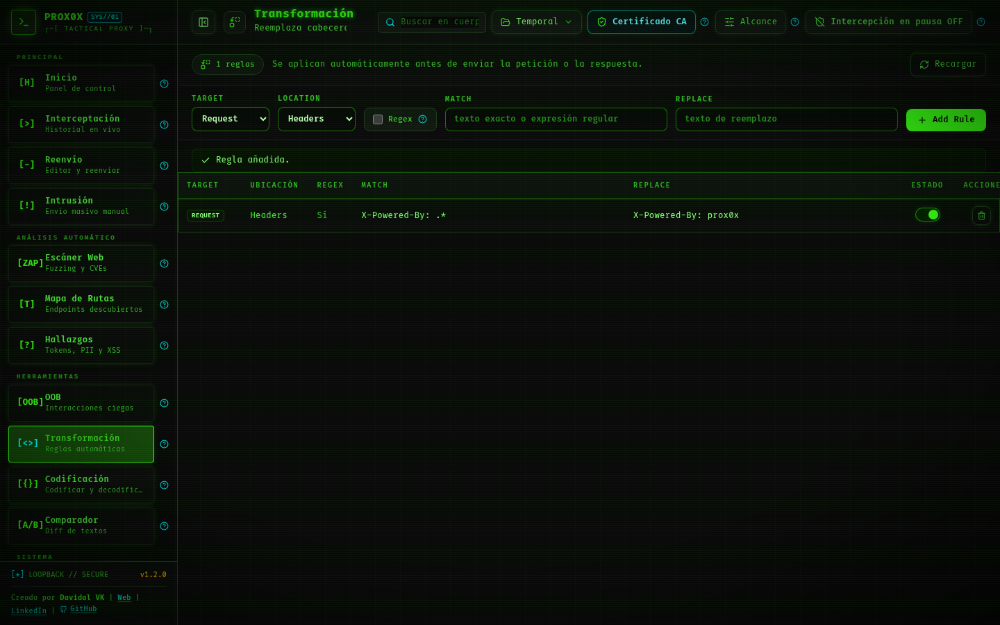

Reglas automáticas de Match & Replace:

- Request o Response.
- Headers, body o todo.
- Texto literal o regex.
- Activar/desactivar reglas.
- Recálculo automático de `Content-Length`.

---

## ⚙️ Ajustes

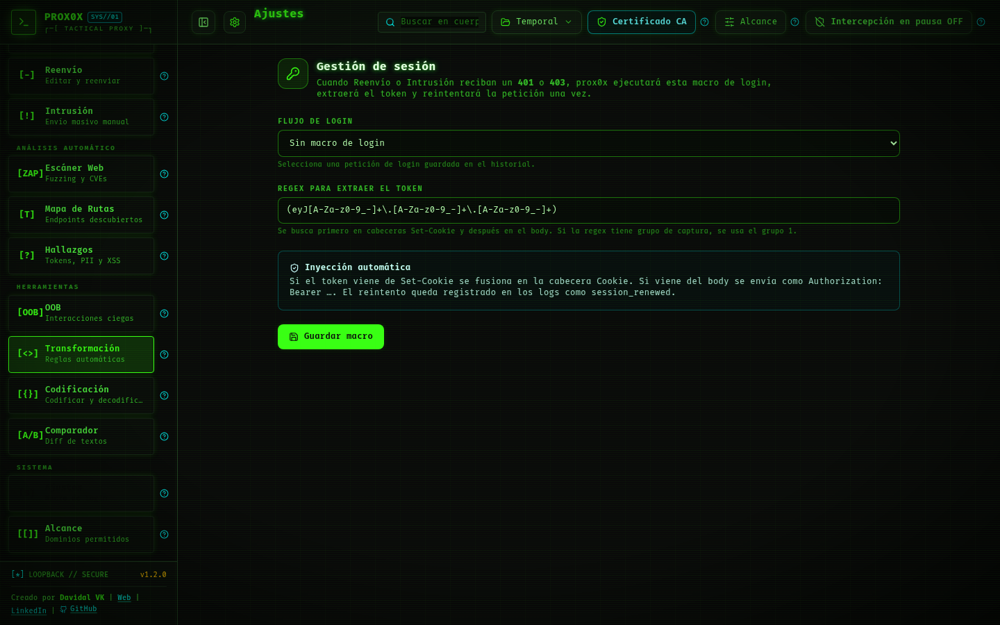

Configuración por proyecto:

- Flow de login.
- Regex para extraer token.
- Renovación automática de sesión ante `401/403`.

---

## 🎯 Alcance (Scope)

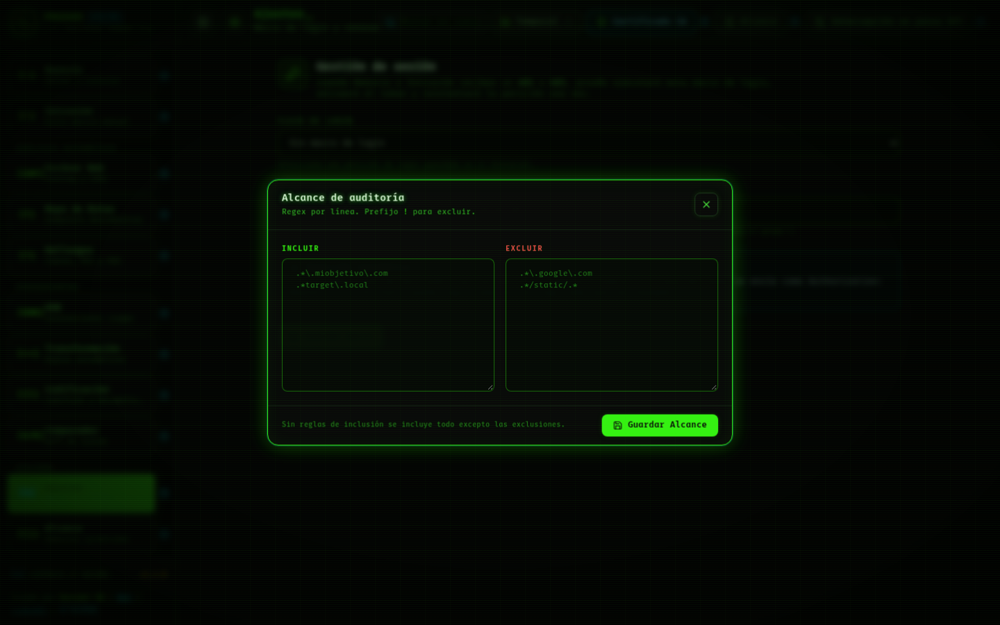

Reglas por línea:

- Inclusión con regex.
- Exclusión con prefijo `!`.
- Filtro visual del historial.
- Reevaluación retroactiva del tráfico ya capturado.

---

## 🗂️ Proyectos y Bienvenida

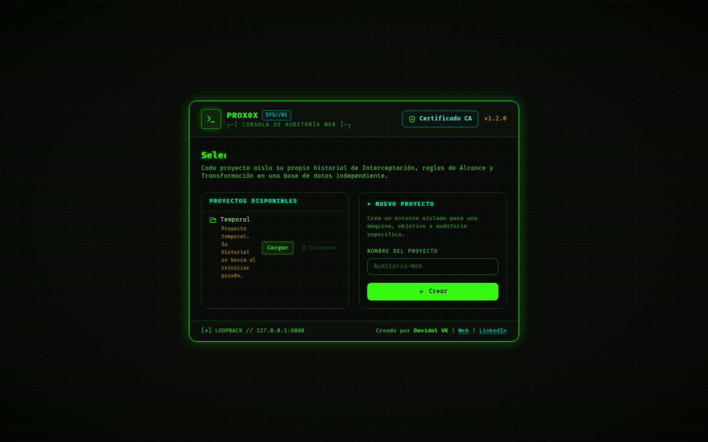

- Pantalla de bienvenida con proyectos disponibles.
- Crear, cargar y eliminar proyectos.
- Cada proyecto aísla:
  - historial;
  - hallazgos;
  - ataques;
  - Alcance;
  - reglas de Transformación;
  - sesión.

El proyecto **Temporal** se borra al reiniciar. Usa un proyecto con nombre para
conservar el trabajo.

---

## 🧰 API y CLI

Además de la UI, prox0x expone:

- API REST en `http://127.0.0.1:8000/docs`.
- WebSockets para tráfico, hallazgos, escaneos y OOB.
- CLI integrada:

```bash
prox0x start
prox0x proxy start
prox0x flows
prox0x crawl http://objetivo.local/ --max-urls 100
prox0x intruder start --from-flow 1 --payload-file payloads.txt
```

### Endpoints destacados

| Método | Endpoint | Descripción |
|---|---|---|
| GET | `/api/health` | Estado y flujos |
| GET | `/api/stats` | Estadísticas del Dashboard |
| GET | `/api/flows` | Historial real (los sintéticos se ocultan) |
| GET | `/api/findings` | Hallazgos |
| POST | `/api/scan/full` | Full Site Scan |
| POST | `/api/scan/batch` | Escaneo de flujos seleccionados |
| POST | `/api/scan/stop/{id}` | Detener escaneo |
| POST | `/api/crawl` | Crawler independiente |
| GET | `/api/sitemap` | Mapa de Rutas |
| GET | `/api/certificate` | Certificado CA |

---

## 🧯 Solución de problemas

### HTTPS muestra error de certificado

- Instala `prox0x-ca.pem` como autoridad de confianza.
- Reinicia el navegador.
- En Firefox, marca explícitamente la confianza para sitios web.

### El Proxy no captura tráfico

- Comprueba que FoxyProxy apunta a `127.0.0.1:8080`.
- Verifica que el Alcance incluye el host.
- Revisa que Intercepción no esté pausada.

### El navegador no abre la UI

```text
http://127.0.0.1:8000
```

### Un escaneo tarda demasiado

- Baja la intensidad.
- Reduce el Alcance.
- Usa **Detener Escaneo**.
- Para zonas privadas, añade cookies o tokens en cabeceras personalizadas.

### No veo los flujos del escáner en Interceptación

Es intencional. Activa **Mostrar tráfico del escáner** en la barra superior.

### Windows SmartScreen bloquea el binario

**Más información** → **Ejecutar de todas formas**.

---

## 🔐 Seguridad y aviso legal

- prox0x está diseñado para **auditorías éticas**.
- Usa la herramienta solo en sistemas propios o con autorización escrita.
- No escanees infraestructuras de terceros sin permiso.
- Revisa el Alcance antes de lanzar ataques.
- Las cabeceras personalizadas pueden contener credenciales: no compartas
  capturas ni logs con secretos.
- El usuario es el único responsable del uso de la herramienta.

---

## 📜 Licencia

prox0x se distribuye bajo la **Licencia MIT**. Puedes usar, copiar, modificar,
fusionar, publicar, distribuir, sublicenciar y vender copias del software,
siempre que se incluya el aviso de copyright y esta licencia. Consulta el
archivo [`LICENSE`](LICENSE).

Copyright © 2026 Davidal VK.

---

## 🧑‍💻 Créditos y Agradecimientos

Creado por **Davidal VK**.

- Web: https://davidalvk.com
- LinkedIn: https://www.linkedin.com/in/davidalvk/
- GitHub: https://github.com/davidalvk/prox0x-releases

### ProjectDiscovery · Nuclei

La integración de CVEs de prox0x utiliza el motor y el catálogo de plantillas
de código abierto de **ProjectDiscovery**:

- [Nuclei](https://github.com/projectdiscovery/nuclei) — motor de escaneo
  basado en plantillas.
- [nuclei-templates](https://github.com/projectdiscovery/nuclei-templates) —
  catálogo comunitario con más de 14.000 plantillas de detección.

Ambos se distribuyen bajo la **Licencia MIT**. El texto completo está
disponible en
[`LICENSE-NUCLEI.md`](LICENSE-NUCLEI.md) y en la
[licencia upstream de nuclei-templates](https://github.com/projectdiscovery/nuclei-templates/blob/main/LICENSE.md).

Gracias a ProjectDiscovery y a toda la comunidad de `nuclei-templates` por
hacer posible esta integración. Gracias también a FastAPI, React, Vite,
Tailwind CSS y lucide por las bases de la interfaz y la API.

---

## 📌 Enlaces

- **Releases:** https://github.com/davidalvk/prox0x-releases/releases
- **Release v1.2.0:** https://github.com/davidalvk/prox0x-releases/releases/tag/v1.2.0
- **Repositorio público:** https://github.com/davidalvk/prox0x-releases

---

<p align="center">
  <strong>prox0x v1.2.0 — Nuclei, Auto-Tech & UX Overhaul</strong><br/>
  Hecho para auditorías éticas, laboratorios y Bug Bounty autorizado.
</p>
